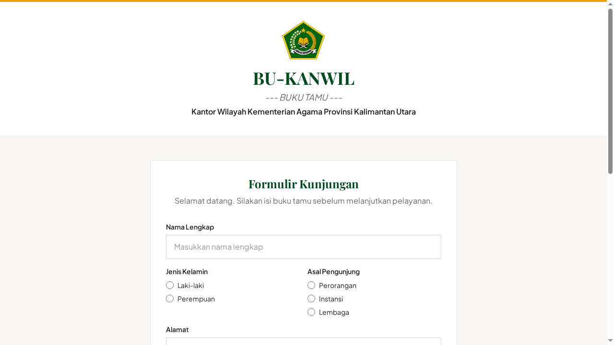

<p align="center">
  
</p>

<h1 align="center">BUKANWIL</h1>

<p align="center">
  <strong>Buku Tamu Kanwil Kemenag Kaltara</strong><br>
  Buku tamu digital dan panel administrasi PTSP Kantor Wilayah Kementerian Agama Provinsi Kalimantan Utara.
</p>

<p align="center">
  <a href="https://bukanwil.is-great.org"></a>
  
  
  
  
  
</p>

## Tampilan

Berikut antarmuka formulir publik yang dapat diakses langsung oleh pengunjung PTSP:

<p align="center">
  
</p>

<p align="center">
  <em>Formulir buku tamu publik yang dapat diisi oleh pengunjung tanpa memerlukan akun atau login.</em>
</p>

## Apa itu BUKANWIL

BUKANWIL (Buku Tamu Kanwil Kemenag Kaltara) menggantikan Google Form yang sebelumnya dipakai untuk mencatat pengunjung PTSP. Aplikasi ini menyediakan dua antarmuka: formulir publik yang dapat diisi langsung oleh tamu tanpa akun, serta panel admin untuk petugas membaca, menyaring, dan mengekspor data kunjungan.

## Fitur utama

### Form buku tamu (publik)

- Isian data nama, jenis kelamin, asal (perorangan, instansi, lembaga), instansi, alamat, nomor HP, dan keperluan.
- Unggah foto tamu bersifat opsional.
- Akses langsung tanpa registrasi atau login.

### Panel admin

- Autentikasi petugas dengan dua tingkat hak akses: superadmin dan admin.
- Dashboard statistik: total tamu, tamu hari ini, tamu belum dibaca, rekap per jenis kelamin dan asal pengunjung, lima keperluan teratas, serta grafik tren 7 hari berbasis Chart.js.
- Daftar tamu terintegrasi dengan penomoran halaman (pagination), pencarian (nama, nomor HP, instansi), penyaringan (tanggal, jenis kelamin, asal, keperluan), dan pengurutan data.
- Halaman detail riwayat kunjungan tamu.
- Ekspor berkas CSV dengan UTF-8 BOM agar langsung terbaca rapi di Microsoft Excel.
- Notifikasi in-app berupa indikator badge untuk data tamu baru yang belum ditinjau.
- Pengelolaan akun petugas admin dan konfigurasi aplikasi.

### Keamanan

- Proteksi CSRF berbasis mode cookie pada `app/Config/Security.php`.
- Proteksi honeypot dan pembatasan laju (rate limit) form publik: 3 pengiriman per 10 menit.
- Pembatasan laju login admin: maksimal 5 kali percobaan gagal per 15 menit.
- Validasi berkas unggahan: verifikasi MIME menggunakan finfo (jpeg, png, webp), whitelist ekstensi, pengacakan nama berkas secara acak, dan batas ukuran maksimal 1 MB.
- Seluruh query database menggunakan CI4 Query Builder (prepared statements).
- Penyimpanan kata sandi menggunakan hash bcrypt dengan cost 12.
- Session hardening untuk mencegah pembajakan sesi.

## Tech stack

- CodeIgniter 4.7.5 dengan runtime PHP 8.3
- MySQL 8.0
- Tailwind CSS v4, aset hasil kompilasi tersedia langsung di `public/css/app.css` dan terikat pada komit repo
- Native JavaScript
- Chart.js (versi di-pin, dimuat melalui CDN)
- Composer dan npm

## Prasyarat

- PHP 8.2 atau versi lebih baru dengan ekstensi intl, mbstring, mysqli, fileinfo, dan json aktif
- MySQL 8.0
- Composer
- Node.js dan npm (hanya dibutuhkan jika ingin mengompilasi ulang styling Tailwind CSS)

## Instalasi dan run lokal

1. Klon repositori dan pasang paket dependensi:

```bash
git clone https://github.com/martinserafim93/bukanwil.git
cd bukanwil
composer install
```

2. Siapkan database lokal lalu impor struktur skema:

```bash
mysql -u root -p -e "CREATE DATABASE bukanwil CHARACTER SET utf8mb4 COLLATE utf8mb4_unicode_ci"
mysql -u root -p bukanwil < database/schema.sql
```

Skema awal menyertakan kredensial akun superadmin default. Segera perbarui kata sandi tersebut melalui menu Kelola Admin setelah berhasil masuk pertama kali.

3. Sesuaikan berkas konfigurasi lokal. Proyek ini tidak menggunakan berkas `.env`; seluruh parameter dikonfigurasi langsung pada berkas config terkait:

- `app/Config/Database.php`: hostname, username, password, dan nama database.
- `app/Config/App.php`: baseURL lokal, contohnya `http://localhost:8080/`.

4. Jalankan server lokal:

```bash
php spark serve
```

Akses aplikasi melalui peramban pada alamat `http://localhost:8080`.

Secara bawaan environment berjalan pada mode `production`. Untuk mengaktifkan mode pengembangan dan bilah penelusuran (debug toolbar), tentukan variabel environment saat memanggil perintah server:

```bash
CI_ENVIRONMENT=development php spark serve
```

Jika Anda memodifikasi tampilan antarmuka atau utilitas class, kompilasi ulang berkas CSS Tailwind:

```bash
npm run build:css
```

## Deploy

Aplikasi saat ini aktif pada lingkungan shared hosting InfinityFree (free tier) di alamat https://bukanwil.is-great.org. Batasan teknis platform ini memengaruhi beberapa arsitektur implementasi: konfigurasi tidak memanfaatkan modul dotenv, Redis, maupun sistem worker queue eksternal, melainkan dikelola langsung melalui berkas `app/Config/*.php`.

Tahapan penyebaran:

1. Eksekusi `composer install` pada mesin lokal untuk memastikan dependensi pada direktori `vendor/` tersedia.
2. Perbarui nilai `baseURL` pada `app/Config/App.php` ke alamat domain target, lalu sesuaikan konfigurasi koneksi database hosting pada `app/Config/Database.php`.
3. Impor berkas `database/schema.sql` ke database MySQL server melalui antarmuka phpMyAdmin.
4. Unggah seluruh direktori proyek via FTP, atau unggah arsip ZIP kemudian ekstrak pada folder target hosting.
5. Konfigurasikan pengalihan domain web server menuju direktori `public/` menggunakan aturan `.htaccess`. Titik masuk utama aplikasi berada pada `public/index.php`.

Pastikan berkas konfigurasi dengan kredensial sensitif tidak diunggah ke repositori publik.

## Struktur direktori

```text
app/                 Kode MVC CodeIgniter 4 (controller, model, view)
app/Config/          Konfigurasi sistem (App.php, Database.php, Security.php, dst.)
public/              Titik masuk publik (index.php), aset gambar, dan CSS terkompilasi
database/schema.sql  Skema struktur tabel dan data awal MySQL
writable/            Penyimpanan berkas log, cache, dan sesi
```
